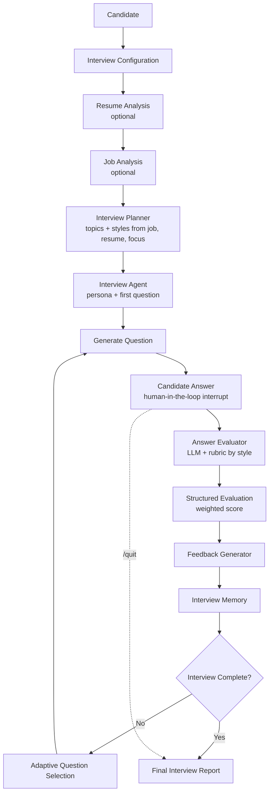

# AI Mock Interview Agent (any role, built from your resume and a job description)

An agentic interview coach built with **LangChain** and **LangGraph**. Give it a job description, a resume,
or both. It plans an interview for that exact role, asks technical, behavioral, situational or case questions
(whatever suits the profession), scores each answer, coaches you instantly, adapts as you go, and ends with a
detailed report including how well you fit the role. It is not limited to Python or to tech roles.

## Architecture (LangGraph state machine, 13 nodes)



| Node | What it does |
|---|---|
| Interview Configuration | Validates input (needs a role, job description, resume or focus topics); loads the candidate's saved profile |
| Resume Analysis | Extracts skills and experiences (facts only, injection-guarded). Skipped without a resume |
| Job Analysis | **Job Description mode:** extracts title, seniority, requirements, responsibilities. Skipped without a JD |
| Interview Planner | LLM picks the topics and their style (technical, behavioral, situational, case): job requirements first, then your focus topics, resume gaps, strongest claims and past weak areas. Infers level if set to auto |
| Interview Agent | Interviewer persona for the role; takes the first agenda item |
| Generate Question | Structured-output LLM call; the plan (not the LLM) controls topic, difficulty, style |
| Candidate Answer | `interrupt()` pauses the graph until the human answers |
| Answer Evaluator | LLM judge with a rubric that changes by style (e.g. STAR specificity for behavioral); injection guard |
| Structured Evaluation | Deterministic score: 0.5 correctness + 0.3 depth + 0.2 clarity |
| Feedback Generator | Specific feedback, one tip, model answer (STAR outline for behavioral) |
| Interview Memory | Appends each turn to state (reducer); skill profile saved at the end |
| Interview Complete? | Done when the agenda is covered and no follow-up is pending |
| Adaptive Question Selection | One follow-up on weak answers; harder when strong, easier when struggling |
| Final Interview Report | Stats in code + LLM narrative incl. "Fit for the role", saved as Markdown |

## Quick start

```bash
python -m venv .venv && source .venv/bin/activate
pip install -r requirements.txt
cp .env.example .env            # add your key (Gemini by default) and MODEL
streamlit run app.py            # web UI: paste/upload a job description, upload a resume

# terminal examples
python -m interview_agent.cli --name Asha --jd job.txt --resume resume.pdf
python -m interview_agent.cli --role "Marketing Manager" --focus "campaign analytics" "stakeholder management"
pytest                          # offline tests, no key needed
```

No API key? `MOCK_LLM=1` runs the whole workflow with a deterministic fake model (used by the tests).

## How it decides what to ask and when to stop

- **What:** the planner combines the job's requirements, your resume (verifying strengths, probing gaps) and any
  focus topics you typed. Up to two **deep-dive questions about your own experience** are woven in.
- **How:** each topic has a style. Engineering roles get mostly technical questions; management or sales roles get
  more behavioral, situational and case questions.
- **When to stop:** there is no question-count setting. The interview ends when the planned agenda is covered
  (plus any follow-ups), or when you press *End interview*. Internal caps (6 topics, 20 questions total) only
  protect against runaway cost.

## Privacy

Resume and job description text are sent to your model provider for analysis. The app does not store them; only
per-topic score averages go into a local profile (`~/.mock_interviewer/`) plus the Markdown reports.
Scanned (image-only) PDFs are not supported without OCR.

## Design decisions worth explaining in interviews

- **LLM for judgment, code for control.** Scoring math, difficulty adaptation, follow-up rules, topic merging and
  stopping are deterministic and unit-tested; only language tasks go to the model.
- **Plan, then execute.** A planner node produces a typed agenda; later nodes follow it, which keeps interviews
  coherent and auditable.
- **Structured output everywhere** (`with_structured_output` + Pydantic) with retries.
- **Human-in-the-loop** via `interrupt()` plus a checkpointer; one `thread_id` per interview.
- **Prompt-injection defense:** answers, resumes and job postings are delimited and treated strictly as data.
- **Coverage-based termination** instead of an arbitrary question count, with a hard safety cap.
- **Two memory layers:** graph state (append reducer) and a per-candidate JSON profile.
- **Testable without an LLM:** fake model plus pure helpers; 11 tests cover flow order, JD mode, any-role behavior,
  resume deep-dives, follow-ups, difficulty adaptation, `/quit`, `/skip`, caps and memory.
- **Observability:** set `LANGSMITH_TRACING=true` to trace every node, prompt and score.

## Resume bullets (edit with your real numbers)

- Built an agentic mock-interview coach with **LangGraph** (13-node stateful workflow with planning, a
  human-in-the-loop interrupt, conditional routing and an adaptive loop) and **LangChain** structured-output calls.
- Designed a plan-then-execute pipeline that turns a job description and resume into a tailored interview
  (technical, behavioral, situational and case questions) for any profession, with rubric-based scoring and a
  role-fit report.
- Added prompt-injection guards, retries, an offline fake-LLM test suite (pytest), LangSmith tracing, and CLI and
  Streamlit interfaces.

## Ideas to extend it

1. **Evaluate the evaluator:** score 30-50 answers by hand, measure judge-human agreement, tune the rubric prompt.
2. **Coding sandbox:** run candidate code against tests for software roles.
3. **Voice mode:** speech-to-text in, text-to-speech out.
4. **Postgres checkpointer** and a FastAPI backend so interviews survive restarts.
5. **Progress dashboard:** score trends per topic and style across sessions.
6. **Company research:** add a web-search tool to tailor questions to the employer.
