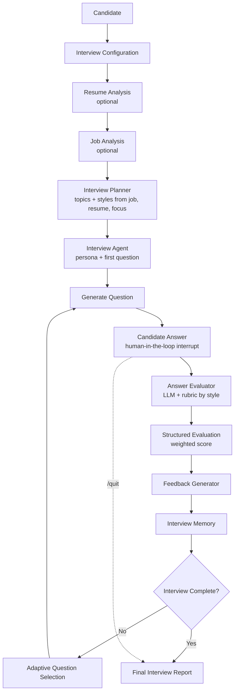

# AI Mock Interview Agent
An agentic AI interview coach built with **LangChain** and **LangGraph**. Give it a **job description**, your **resume**, or both. It plans an interview for that exact role, asks questions in the style that suits the profession (technical, behavioral, situational or case), scores every answer, coaches you right away, adapts as you go, and finishes with a detailed report that includes how well you fit the role.


It works for **any profession**, not only software roles.


## Features

- **Job Description mode:** paste or upload a job posting; questions are built around its requirements and responsibilities.
- **Resume-aware:** extracts your skills and experience, verifies your strongest claims, probes gaps against the job, and asks deep-dive questions about your own projects or roles.
- **Any role, right style of question:** technical for hands-on skills, behavioral (STAR) for past experience, situational for hypothetical scenarios, and case questions for structured problem-solving.
- **Adaptive:** weak answers earn one targeted follow-up; strong answers raise the difficulty; struggling candidates get easier questions.
- **No fixed question count:** the interview ends when everything planned is covered, or when you choose to end it.
- **Instant coaching:** after every answer you get a score, specific feedback, one improvement tip and a model answer.
- **Final report:** overall score, per-topic breakdown, strengths, improvements, a study plan, a role-fit summary and a question-by-question review, saved as Markdown.
- **Remembers you:** keeps per-topic scores across sessions so the planner can revisit weak areas.
- **Two interfaces:** Streamlit web app and a terminal CLI.
- **Works with several model providers** through LangChain (Gemini by default; OpenAI, Anthropic and others are a one-line change).


## How it works

The interview is a LangGraph state machine. Language tasks go to the LLM; control logic (scoring math, difficulty changes, follow-up rules, stopping) is plain, tested Python.



| Node | What it does |
|---|---|
| Interview Configuration | Validates input (needs a role, job description, resume or focus topics) and loads the candidate's saved profile |
| Resume Analysis | Extracts skills and experiences (facts only). Skipped without a resume |
| Job Analysis | Extracts title, seniority, requirements and responsibilities. Skipped without a job description |
| Interview Planner | Chooses topics and their style from the job requirements, your focus topics, resume gaps, strongest claims and past weak areas; infers level when set to auto |
| Interview Agent | Sets the interviewer persona for the role and takes the first item from the agenda |
| Generate Question | Structured-output LLM call; the plan controls topic, difficulty and style |
| Candidate Answer | Pauses the graph with `interrupt()` until the candidate answers (`/skip` and `/quit` supported) |
| Answer Evaluator | LLM judge with a rubric that changes by question style |
| Structured Evaluation | Deterministic score: 0.5 correctness + 0.3 depth + 0.2 clarity |
| Feedback Generator | Specific feedback, one tip, and a model answer (a STAR outline for behavioral questions) |
| Interview Memory | Appends each turn to the graph state; the skill profile is saved at the end |
| Interview Complete? | Done when the agenda is covered and no follow-up is pending |
| Adaptive Question Selection | One follow-up on weak answers; adjusts difficulty; otherwise the next agenda item |
| Final Interview Report | Statistics in code plus an LLM-written narrative, saved as Markdown |

## Tech stack

- **LangChain 1.x:** model interface, structured output (`with_structured_output`), retries
- **LangGraph 1.x:** state graph, conditional edges, `interrupt()` for human-in-the-loop, checkpointing
- **Pydantic v2:** typed schemas for every LLM call and node output
- **Streamlit:** web interface
- **pypdf:** resume and job description PDF text extraction
- **pytest:** offline test suite with a fake model
- **LangSmith (optional):** tracing and observability

## Quick start

### 1. Clone and install

**Windows (PowerShell)**
```powershell
git clone https://github.com/Samcoderg78/AI-mock-interview-agent.git
cd AI-mock-interview-agent
python -m venv venv
.\venv\Scripts\Activate.ps1
pip install -r requirements.txt
copy .env.example .env
```

**macOS / Linux**
```bash
git clone https://github.com/Samcoderg78/AI-mock-interview-agent.git
cd AI-mock-interview-agent
python -m venv venv
source venv/bin/activate
pip install -r requirements.txt
cp .env.example .env
```

### 2. Add your API key

Open `.env` and set your key. The default is Google Gemini:

```
MODEL=google_genai:gemini-2.5-flash
GOOGLE_API_KEY=your-key-here
```

To use another provider, change `MODEL` (format `provider:model`), set that provider's key, and install its package, for example `pip install langchain-openai` with `MODEL=openai:gpt-4o-mini` and `OPENAI_API_KEY=...`. Model names change over time, so check your provider's docs for the current one.

### 3. Run it

**Web app**
```bash
python -m streamlit run app.py
```

**Terminal**
```bash
# job description + resume
python -m interview_agent.cli --name Asha --jd job.txt --resume resume.pdf

# role and focus topics only
python -m interview_agent.cli --role "Marketing Manager" --focus "campaign analytics" "stakeholder management"
```

During an interview, type `/skip` to skip a question or `/quit` to end the interview and get your report.

**No API key?** Set `MOCK_LLM=1` to run the whole workflow with a deterministic fake model. It is meant for demos of the flow and for tests, not for realistic questions.

## Configuration

| Setting | Where | Description |
|---|---|---|
| `MODEL` | `.env` | Model as `provider:model` (default `google_genai:gemini-2.5-flash`) |
| `GOOGLE_API_KEY` etc. | `.env` | API key for your provider |
| `MOCK_LLM=1` | `.env` | Use the offline fake model |
| `MOCK_INTERVIEW_HOME` | `.env` | Folder for saved reports and the candidate profile (default `~/.mock_interviewer`) |
| `LANGSMITH_TRACING=true` | `.env` | Trace every node and prompt in LangSmith (also set `LANGSMITH_API_KEY`) |

Internal limits (not user settings): at most 6 topics, 2 resume deep-dives, 1 follow-up per topic and 20 questions per interview. They keep cost predictable.

## Project structure

```
.
├── app.py                    # Streamlit web interface
├── interview_agent/
│   ├── graph.py              # LangGraph wiring (nodes and edges)
│   ├── nodes.py              # node functions and pure helpers (agenda, follow-ups, difficulty)
│   ├── prompts.py            # all prompts in one place
│   ├── schemas.py            # Pydantic models for config, plan, questions, evaluation, report
│   ├── state.py              # graph state definition
│   ├── llm.py                # model factory and offline fake model
│   ├── memory.py             # cross-session candidate profile and report saving
│   ├── report.py             # statistics and Markdown report rendering
│   ├── resume.py             # PDF / text extraction
│   └── cli.py                # terminal interface
├── tests/test_flow.py        # offline tests (no API key needed)
├── requirements.txt
└── .env.example
```

## Testing

```bash
pytest -q
```

The 11 tests run against a fake model, so they need no API key and cost nothing. They cover node order, job-description planning, behavior for non-technical roles, resume deep-dives, follow-ups, difficulty adaptation, `/skip`, `/quit`, the safety caps and cross-session memory. They verify the **workflow**, not the quality of the LLM's questions or scores.

## Design decisions

- **LLM for judgment, code for control.** Score weighting, follow-up rules, difficulty changes, topic merging and stopping are deterministic and unit-tested.
- **Plan, then execute.** A planner node produces a typed agenda that later nodes follow, which keeps interviews coherent and easy to audit.
- **Structured output everywhere.** Every LLM call returns a validated Pydantic object, with retries.
- **Human-in-the-loop.** `interrupt()` plus a checkpointer pauses the graph for each answer; each interview has its own `thread_id`.
- **Prompt-injection defense.** Answers, resumes and job postings are wrapped in tags and treated strictly as data to analyze, never as instructions.
- **Coverage-based stopping.** The interview length follows what needs to be covered, with a hard cap for cost safety.

## Privacy

Resume and job description text are sent to your chosen model provider for analysis. The app does not store that text. It saves only per-topic score averages (a local profile) and the Markdown reports, in `~/.mock_interviewer/` by default. Do not commit those folders; the included `.gitignore` excludes them.

## Limitations

- Scanned (image-only) PDFs are not supported; use a text-based PDF or paste the text.
- Only the first 12,000 characters of a resume or job description are used.
- The LLM judge has **not** been validated against human ratings, so treat scores as guidance, not a verdict.
- The interview state is held in memory, so closing the app mid-interview loses it.
- Free-tier API limits can slow or interrupt an interview, since each answer triggers several model calls.
- Tested mainly with English-language input.

## Roadmap

- [ ] Measure judge-human agreement on a hand-scored set of answers and tune the rubric prompts
- [ ] Coding questions with a sandboxed test runner for software roles
- [ ] Persistent checkpointing (SQLite or Postgres) so interviews survive restarts
- [ ] Voice mode (speech-to-text and text-to-speech)
- [ ] Progress dashboard with score trends across sessions
- [ ] Company research tool to tailor questions to the employer


## Author

Built by [@Samcoderg78](https://github.com/Samcoderg78).
